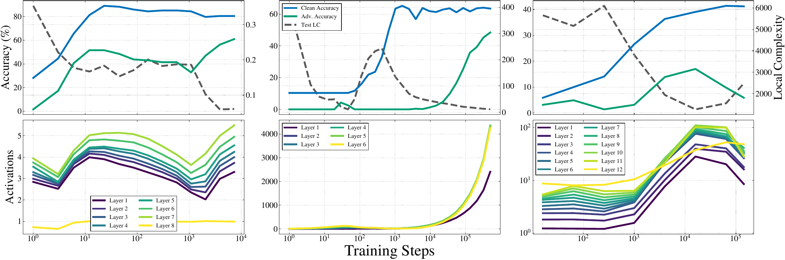

# Understanding the Importance of Massive Activations through Adversarial Robustness

## Abstract

A common occurrence in Large Language Models (LLMs) is the emergence of so-called *massive activations*. This phenomenon is well known in the literature and has been connected to attention sinks, representational compression, as well as signal propagation. However, the reasons and consequences for their appearance are not yet well understood. In this paper, we explain the role of massive activations in deep learning by showing that they are connected to the *region migration* phenomenon in delayed robustness. Under the spline theoretic interpretation of deep networks, we show that massive activations push the representations away from the nonlinearity boundaries of the network, decreasing the complexity of its input-output map around data points. Furthermore, we uncover for the first time that this phenomenon is not unique to transformers, and actually appears in a number of common architectures performing simple supervised learning tasks. We validate this connection through extensive experiments on a diverse set of architectures including residual MLP, ResNet18, Vision Transformer and GPT and datasets including MNIST, CIFAR10, Imagenette and Shakespeare Text. We consistently observe that massive activations and region migration co-occur with adversarial robustness. Furthermore, we illustrate that this connection holds in the large-scale pretraining of LLMs, by showing that the rise of massive activations in LLMs closely tracks the adversarial accuracy of the model under perturbations of the token embeddings.



*Emergence of region migration and adversarial robustness with massive activations. Accuracy, adversarial accuracy and local complexity (top row) and layerwise activation magnitudes (bottom row) for a residual MLP on MNIST (left), GPT on Shakespeare Text (middle), and Pythia 160M on The Pile (right).*

## Using the Code


### Setup

```bash
git clone https://github.com/tigranfah/ma-robustness.git
cd ma-robustness
conda env create -f environment.yml
conda activate grok
```


### Training

Training scripts are located in `scripts/`:


| Model                        | Entry point                    |
| ---------------------------- | ------------------------------ |
| Residual MLP on MNIST        | `scripts.fcn_mnist_grokking`   |
| ResNet18 on CIFAR10          | `scripts.resnet18_cifar10`     |
| ViT on CIFAR10 or Imagenette | `scripts.vit_imagenette`       |
| GPT on Shakespeare           | `scripts.gpt_shakespeare_text` |


**Example:** To train a GPT on Shakespeare Text use

```bash
python -m scripts.gpt_shakespeare_text \
  --exp_id gpt-shakespeare \
  --data_path data/shakespeare.txt \
  --n_layer 6 --n_head 6 --n_embd 384 \
  --block_size 256 --batch_size 64 \
  --lr 0.001 --weight_decay 0.0 \
  --num_steps 500000 --seed 0 --adv_eps 0.01
```


### Evaluation

Scripts for computing the activation magnitudes, local complexity (LC), and adversarial accuracy are located in `utils/`.

**Example:** To evaluat GPT checkpoints use

```bash
python -m utils.gpt_compute_metrics \
  --checkpoint_dir checkpoints/gpt-shakespeare \
  --data_path data/shakespeare.txt \
  --adv_eps 0.01 --adv_steps 10 --adv_restarts 1 \
  --adv_positions 8 --adv_sequences 64 \
  --save_path results/gpt
```


## Citation

```bibtex
@misc{fahradyan2026massive,
  title = {Understanding the Importance of Massive Activations through Adversarial Robustness},
  author = {Fahradyan, Tigran and Ali, Riccardo and Calvo-Ordo{\~n}ez, Sergio and Hern{\'a}ndez-Lobato, Jos{\'e} Miguel and Li{\`o}, Pietro and Arroyo, {\'A}lvaro},
  year = {2026}
}
```

